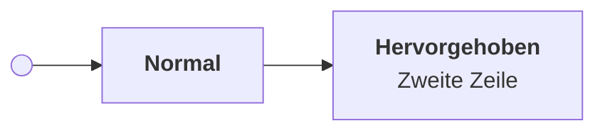

# mpe-notion-theme

Notion-Look für die **Markdown Preview Enhanced** Vorschau in VS Code, inklusive passend gestylter Mermaid-Diagramme. Die Konfiguration liegt in diesem Repo, damit sie auf allen Geräten identisch ist.

## Was drin ist

| Datei | Zweck |
| --- | --- |
| `style.less` | Das Theme: zentrierte Spalte (max. 900px), Notion-Typografie, Code, Tabellen, Zitate, Hell und Dunkel (folgt VS Code) und das Styling aller Mermaid-Diagramme |
| `config.js` | Crossnote-Config mit der Mermaid-Konfiguration: klassischer Look, Schrift, Abstände, gerade Linien |
| `skills/mermaid-theme` | Agent-Skill: Diagramme nutzen nur die Theme-Klassen und definieren keine Farben |
| `install.sh` | Verlinkt beide Dateien in `~/.local/state/crossnote/` (Backup der alten Dateien als `.bak`) |

## Einrichten auf einem neuen Gerät

```bash
git clone <repo-url> ~/Projects/mpe-notion-theme
~/Projects/mpe-notion-theme/install.sh
```

Danach in VS Code `Cmd+Shift+P` und `Developer: Reload Window`. Auf Windows liegt das Verzeichnis unter `%USERPROFILE%\.local\state\crossnote`, dort die Dateien manuell kopieren oder verlinken.

Weil `install.sh` Symlinks setzt, landen Änderungen über `Markdown Preview Enhanced: Customize CSS` direkt in diesem Repo. Dann nur noch committen und pushen.

## Änderungen testen

Die Preview überschreibt standardmäßig `margin` mit `0`. Eine gezielte Regel für den Preview-Container hält die Spalte trotzdem mittig. Der Hintergrund neben der Spalte folgt dem hellen oder dunklen Theme.

- Änderungen an `style.less`: Vorschau neu laden.
- Änderungen an `config.js` (Mermaid-Optionen): Window neu laden, sonst greifen sie nicht.

## Mermaid-Diagramme

Das Theme nutzt Farb-Variablen (`--m-node`, `--m-cluster`, `--m-stroke`, `--m-line`, `--m-text`) für hell und dunkel, sodass sich Farben an einer Stelle ändern lassen.

Zusätzlich gibt es zwei Klassen, die man im Diagramm setzen kann:



- `:::accent`: blau hervorgehobene Box
- `:::dot`: gefüllter Punkt, zum Beispiel für Start und Ende
- `:::ok`, `:::warn`, `:::bad`: grün, gelb, rot für Status
- `:::code`, `:::llm`, `:::human`, `:::gate`, `:::store`: Knotenarten (Code, Modell, Mensch, Entscheidung, Ablage), jeweils mit hellem und dunklem Farbpaar

Das Theme erzwingt Füllung, Rand und Textfarbe mit `!important`. Ein `classDef`, `style` oder `color:` im Diagramm hilft deshalb nicht. Diagramme weisen nur Klassen zu. Für Agents liegt die Regel im Skill `skills/mermaid-theme`; zum Installieren `ln -s <repo>/skills/mermaid-theme ~/.agents/skills/mermaid-theme`.

Boxen mit Titel und Beschreibung schreibt man als `["<b>Titel</b><br/>Beschreibung"]`.

## Bekannte Grenzen

- Mermaid rundet Rauten nicht ab und setzt Abzweigungen immer eine Ebene tiefer. Für Entscheidungen sind deshalb Sechsecke `{{"..."}}` mit etwas Padding im Label im Einsatz.
- Die Schriftgröße der Diagramme kommt aus `config.js`. Per CSS geändert, wird Text abgeschnitten, weil Mermaid die Boxbreite vor dem Styling misst.
- Ob das Layout bei neuen Mermaid-Versionen stabil bleibt, ist ungeprüft. Getestet ist die Version aus MPE 0.8.39.
