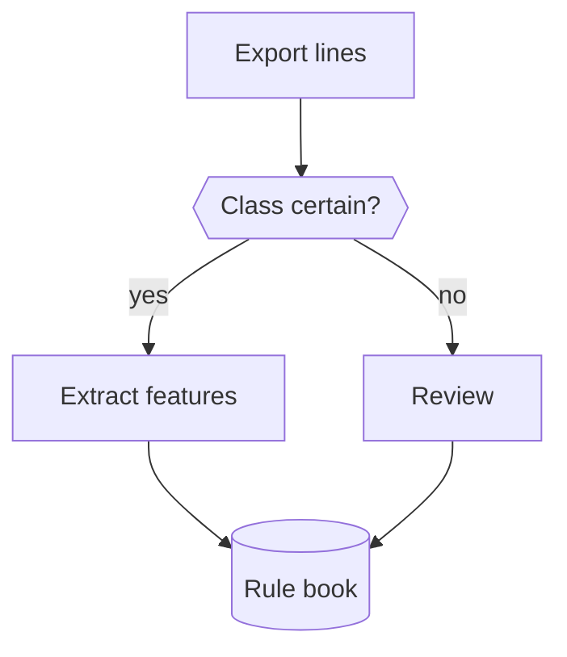

# Mermaid Theme

The MPE Notion theme (`style.less` in this repo) colors Mermaid nodes by CSS class, separately for light and dark, and forces node and text colors with `!important`. A `classDef`, `style` or `color:` in the diagram is therefore either redundant or fights the theme. **Diagrams assign classes. They never define colors.**

## Rules

1. Give every node one class from the table. Use `:::name` on the node or `class A,B,C name` at the end.
2. Do not write `classDef`, `style`, `linkStyle`, hex colors or `%%{init}%%`.
3. Pick the class by what the node is, not by what looks nice. A new meaning means a new class in `style.less` first, then a row here.
4. If more than one class appears, add a one-line legend under the diagram in words, not hex.
5. Long labels: quote them and break with ` ` at about 40 characters. Titles with description: `["<b>Title</b> Description"]`.
6. Decisions are hexagons `{{"..."}}`, not diamonds. The theme does not round diamonds.

## Classes

| Class | Meaning | Use for |
|---|---|---|
| `code` | Deterministic code | parsers, joins, rules, checks |
| `llm` | Model step | LLM calls, judging, extraction |
| `human` | Human step | review, approval, decision by a person |
| `gate` | Decision | branching questions |
| `store` | Persistent artifact | rule book, tables, files, databases |
| `accent` | Highlight | one node the reader must not miss |
| `ok` / `warn` / `bad` | Status | green, yellow, red outcomes |
| `dot` | Start or end | `S(( )):::dot` |

Subgraphs are styled by the theme as neutral layers. Use them to group steps, not to color them.

## Example

## Outside the theme

On GitHub or in Notion the classes have no styling and nodes render in the default colors. That is accepted. Do not add `classDef` fallbacks to the diagram.
